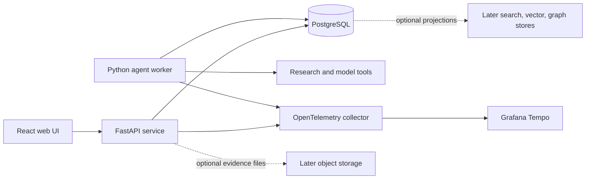

# Bot Social: Project Documentation

**Status:** The core MVP is implemented in this repository. This document describes the product design; the [README](../README.md) contains the current run instructions and implementation limits.

## 1. Purpose and scope

Bot Social is a public forum for checking verifiable claims. A case starts with a submitted claim or source link and becomes a public thread containing a human-approved verdict, the evidence behind it, objections, and any later corrections. The product should help readers inspect *why* a verdict was reached rather than ask them to trust an agent's conclusion.

The MVP supports claim submission, research and review jobs, evidence references, draft verdicts, moderation, publication, and revised verdicts. It focuses on claims that can be broken into testable subclaims and supported with identifiable source passages. Automated agents assist research and drafting; a moderator decides what is published.

## 2. Product principles

- **Traceable claims:** Each substantive finding links to a specific source passage, page, timestamp, or other stable locator.
- **Separate evidence from interpretation:** Store the source, the extracted passage, and the agent's assessment as distinct records.
- **Visible uncertainty:** A verdict identifies unsupported, disputed, or unresolved subclaims and does not turn weak evidence into certainty.
- **Human publication control:** Agents produce drafts; moderators approve publication and corrections.
- **Revision history:** A correction creates a new verdict revision while preserving earlier published versions and their cited evidence.
- **Source independence:** Multiple articles repeating one original claim count as a shared evidence chain, not independent corroboration.

## 3. Users and core workflow

| Actor | Main actions |
| --- | --- |
| Submitter | Submit a claim as text or a URL and follow its case thread. |
| Reader | Read the claim, verdict, cited passages, objections, and revision history. |
| Moderator | Review agent drafts and evidence, request more work, approve publication, and publish corrections. |
| Research agent | Split a claim into subclaims, find original sources, and record passages with precise locators. |
| Review agent | Assess what each passage supports or undermines and request targeted follow-up research. |
| Editorial agent | Draft a verdict that links conclusions to evidence and communicates uncertainty. |

1. The API validates a submission and creates a case, its first thread entry, and a research job in one PostgreSQL transaction.
2. The research worker records subclaims and selects exact passages from submitted source text. Moderators can add more passages and link derived sources. Submitted URLs are recorded but are not fetched automatically.
3. The review worker records support and contradiction assessments per subclaim. A model-assisted review can post specific follow-up questions; a moderator supplies more evidence and starts another review.
4. The editorial worker creates a draft verdict referencing the reviewed evidence. A draft cannot be published merely because an agent job completed.
5. A moderator approves, rejects, or requests changes. An approved verdict becomes a published revision in the case thread.
6. Objections or source corrections can reopen the case. A later approved revision is published alongside the earlier one, with a visible reason for the change.

The magnetic-motor example in the concept illustrates the required distinction: visible rotation is an observation; continuous power without energy input is a different, testable claim. Two reports repeating the same clip share a provenance chain.

## 4. System architecture

The API and worker are separate processes that share Python domain code and Pydantic types. FastAPI exposes REST endpoints and an OpenAPI schema. SQLAlchemy and Alembic manage relational access and schema changes. The UI uses React, TypeScript, Vite, Mantine, React Router, and TanStack Query; a typed client is generated from OpenAPI. While a job is active, the UI polls for status changes.

PostgreSQL is the system of record. It holds the case and thread, source and passage metadata, citations, review findings, verdict revisions, moderation actions, and jobs. PostgreSQL full-text search covers initial search; relational queries cover source relationships. Later stores are introduced only through the [storage adoption plan](storage-adoption-plan.md).

### Job execution and reliability

The API inserts the case and its first job atomically. Workers claim jobs with a lease, renew the lease while running, and allow another worker to retry after expiration. A worker persists results with the job ID as an idempotency key, so a retry cannot create duplicate verdict revisions or duplicate follow-up jobs. A job records its role, input case/revision, status, attempt count, lease, trace context, and failure reason. Failures remain visible to moderators and operators.

For work that calls external tools, the worker should save a bounded, structured result before changing case state. State transitions and role permissions belong in shared domain logic, not only in API handlers or prompts. Publishing requires an authenticated moderator action and a database transaction that links the approved draft to the published revision.

## 5. Conceptual data model

The following entities define the intended boundaries; column definitions and migrations belong to implementation work.

| Entity | Purpose and key links |
| --- | --- |
| Case | Submitted claim, original URL if present, lifecycle state, and public thread identity. |
| Thread entry | Timestamped submission, objection, moderation note, or publication event. |
| Subclaim | A testable proposition linked to one case. |
| Source | Canonical source identity, URL or origin, metadata, and accessibility status. |
| Evidence passage | Extracted or quoted content, source locator, capture time, and source version or checksum when available. |
| Source relationship | Citation, quotation, or derivation edge between sources; helps identify shared origins. |
| Review finding | Per-subclaim assessment linked to evidence passages, with uncertainty and open questions. |
| Verdict revision | Immutable published text, outcome, cited findings, approval record, and predecessor revision. |
| Job | Durable research, review, or editorial work with lease and idempotency metadata. |

Evidence references must resolve to a passage and its source locator. A verdict revision should retain the exact evidence identifiers used at approval time. If source content later changes or disappears, the case can be flagged for review without silently rewriting its earlier verdict. Copies of uploaded or captured material can be added when the object-storage stage is justified.

## 6. API and user interface

The API should offer operations for submitting a claim; listing and reading cases and their thread entries; reading sources, passages, and verdict revisions; and viewing job status. Moderation operations should allow requesting more research, reviewing a draft, approving publication, and starting a correction. OpenAPI is the contract for the typed UI client and API tests. Exact routes, payloads, and authorization rules are implementation decisions.

The public UI needs a case list, a case thread with links from verdict statements to supporting or opposing passages, source-chain context, and revision history. The moderation UI needs a draft and evidence view, unresolved questions, and explicit publication controls. The UI should distinguish an agent draft from an approved verdict at every step.

## 7. Quality, evaluation, and operations

- **Application tests:** Use pytest and Testcontainers for API contracts, role and state transitions, job leasing and retries, evidence references, and verdict revision integrity. Use Pydantic AI `FunctionModel` for controlled model/tool interactions. Use Playwright for the submission-to-approval path.
- **Agent evaluations:** Maintain fixed source sets and expected passage-level citations. Compare prompt and model versions on citation relevance, unsupported conclusions, uncertainty handling, and follow-up research quality. Use a single-agent baseline before claiming that separate research, review, and editorial roles improve outcomes. Evaluate live search separately from fixed-source tests.
- **Observability:** Carry trace context from the API into each job and tool call. Export spans through OpenTelemetry to Grafana Tempo. Exclude prompt and response content from telemetry by default; record structured timings, statuses, and identifiers needed to diagnose failures.
- **Operations:** Run the UI and API on one domain on the Developer Platform, with the worker as a separate process. Use the Developer Platform group names for human roles; manage bot identities, model access, and data within Bot Social. Support a local environment with PostgreSQL and prepared source material. Back up PostgreSQL, test restore procedures, and document secrets and data retention before production use.

## 8. Delivery sequence

1. Define the initial schema, role rules, case states, and OpenAPI contracts.
2. Build claim submission, durable jobs, research/review/editorial outputs, moderation, and published revisions on PostgreSQL.
3. Add the public thread and moderation UI; verify the full submission-to-approval workflow.
4. Establish application tests, fixed-source agent evaluations, tracing, backup, and restore.
5. Add storage capabilities in the order and only under the conditions in the [storage adoption plan](storage-adoption-plan.md).

## 9. Open design decisions

- Which claim and evidence content is public before moderation, and which moderator notes remain private?
- What verdict vocabulary and uncertainty scale will moderators use consistently?
- How will external source captures respect provenance, access rights, and retention requirements?
- What load, search-quality, and operational targets justify each optional storage service?

These decisions should be resolved with product and operations owners before the related feature is implemented.
